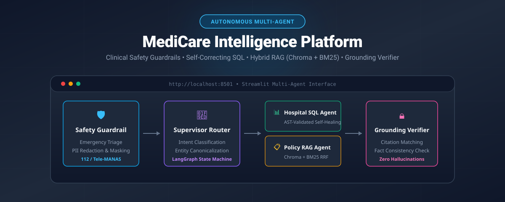
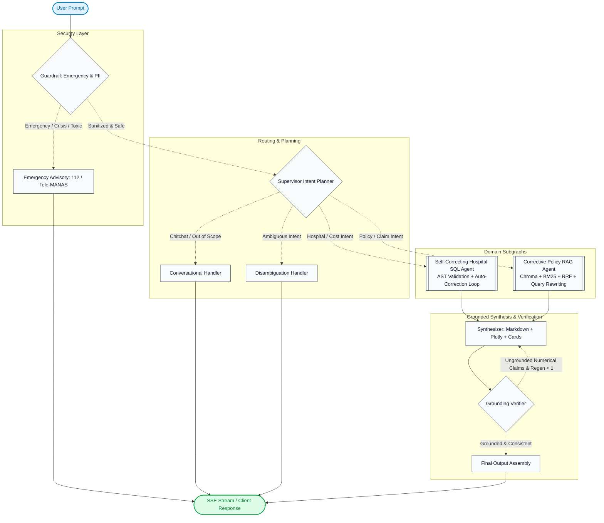

<div align="center">

# MediCare: Autonomous Multi-Agent Clinical & Claim Intelligence Platform

<p align="center">
  <strong>An enterprise-grade, production-ready multi-agent AI system for healthcare procedural cost comparisons, hospital wait times, and health insurance policy navigation.</strong>
</p>

[](https://www.python.org/)
[](https://fastapi.tiangolo.com/)
[](https://streamlit.io/)
[](https://github.com/langchain-ai/langgraph)
[](https://www.trychroma.com/)
[](https://github.com/astral-sh/ruff)
[]()
[]()
[]()

<br/>

**Architected & Engineered by [Palash Rajpara](https://github.com/palashrajpara)**  
[](https://github.com/palashrajpara)
[](https://linkedin.com)
[](mailto:palashrajpara15@gmail.com)

---

### 🖥️ Interactive System Preview



> 💡 *To replace this with an animated screen recording of your live app, record a 10-second capture of the Streamlit UI and save it as `docs/assets/demo.gif`.*

<br/>

[System Architecture](#-system-architecture) • [Multi-Agent Breakdown](#-autonomous-agent-breakdown) • [Key Technical Innovations](#-key-technical-innovations) • [Evaluation Benchmarks](#-evaluation--benchmarks) • [Quickstart](#-quickstart) • [Repository Structure](#-repository-structure) • [Author](#-author)

</div>

---

## 📌 Executive Summary & Problem Statement

Navigating healthcare expenses and insurance claims is notoriously opaque:
- **Wide Price Variance**: The exact same procedure (e.g., Cataract surgery or Knee replacement) varies in cost by over 300% across hospitals in the same city.
- **Complex Policy Clauses**: Waiting periods, room-rent sub-limits, disease-specific copays, and exclusions are buried across 80+ page insurance PDF documents.
- **LLM Financial Hallucinations**: Standard conversational models frequently fabricate prices, cite non-existent clauses, or give dangerous medical advice during clinical emergencies.

**MediCare** solves this with a **hierarchical multi-agent state machine** built on **LangGraph**. It combines an AST-validated self-correcting SQL agent for structured cost directories, a hybrid dense-sparse RAG agent for policy documents, deterministic factual grounding to eliminate hallucinations, and sub-millisecond safety guardrails.

---

## 🏗️ System Architecture

The core runtime is an event-driven directed acyclic graph (DAG) orchestrated by `MediCareGraph`. It coordinates isolated worker subgraphs with bounded self-correction loops and streaming state checkpoints.



---

## 🤖 Autonomous Agent Breakdown

Each agent in the platform owns a dedicated stage in the LangGraph execution pipeline:

| Agent / Node | Module | Role & Autonomous Capabilities |
| :--- | :--- | :--- |
| **🛡️ Clinical Safety Guardrail** | `medicare/security/guardrails.py` | Runs in **< 0.2 ms**. Intercepts medical emergencies, chest pain, stroke, or suicide distress and immediately triggers national helplines (`112`, `14416` Tele-MANAS). Redacts Indian PII (Aadhaar, PAN, phone numbers, policy numbers). |
| **🧭 Supervisor Planner** | `medicare/medicare/graph/nodes_parent.py` | Classifies intent into `hospital_sql`, `policy_rag`, `hybrid`, `conversational`, or `clarification`. Canonicalizes entities (e.g. mapping "bombay" → "Mumbai", "heart attack" → "Cardiology"). Preserves conversational context across turns. |
| **📊 Hospital SQL Agent** | `medicare/medicare/graph/sql_subgraph.py` | Inspects live SQLite schema, generates read-only `SELECT` queries, validates AST safety, executes parameter-bound queries, and executes an **autonomous 3-attempt self-correction loop** if syntax or column errors occur. |
| **📋 Corrective Policy RAG Agent** | `medicare/medicare/graph/policy_subgraph.py` | Executes hybrid retrieval (dense ChromaDB cosine similarity + sparse BM25Okapi lexical matching) fused via Reciprocal Rank Fusion ($K=60$). Evaluates chunk relevance and automatically rewrites queries if thresholds are not met. |
| **🔒 Deterministic Grounding Verifier** | `medicare/medicare/graph/verify.py` | Pure-code fact-checker. Extracts all numbers, currency figures (₹), copay percentages, and waiting periods from the draft answer and verifies them against the raw database results and cited document spans before sending to the user. |
| **✍️ Synthesizer Agent** | `medicare/medicare/graph/nodes_parent.py` | Combines narrative explanation, interactive Plotly charts, data comparison tables, and clickable verbatim policy citation popovers. |

---

## ⚡ Key Technical Innovations

### 1. Dual-Engine Hybrid Retrieval with Reciprocal Rank Fusion (RRF)
To prevent vocabulary mismatch between formal insurance terminology and informal user queries, the RAG agent combines dense embeddings with lexical BM25 token matching, scoring documents via RRF:
$$RRF(d) = \sum_{m \in \{\text{dense}, \text{bm25}\}} \frac{1}{60 + \text{rank}_m(d)}$$
Candidate chunks with Jaccard token similarity $> 0.85$ are dynamically filtered to maximize source diversity.

### 2. AST-Validated Self-Healing SQL Sandbox
- Queries are parsed into Abstract Syntax Trees before execution to enforce strict read-only execution (preventing `DROP`, `UPDATE`, `INSERT`, or stacked queries).
- When a query fails (e.g. schema hallucination or missing column), the runtime captures the SQLite error message, injects the real schema context, and triggers an autonomous self-repair prompt (averaging 0.43 retries per complex query).

### 3. Multi-Format Ingestion Engine
Ingests 6 distinct document formats with physical page boundary isolation:
- **PDF**: Header/footer suppression and layout boundary preservation.
- **DOCX**: Heading hierarchy tree traversal.
- **Markdown**: Heading path context prepend (`# Policy > Exclusions > Waiting Periods`).
- **HTML**: DOM sanitization and structured content extraction.
- **CSV & Plain Text**: Row-grouped and semantic paragraph chunking.

### 4. Zero Hardcoding Architecture
- 100% of UI titles, taglines, suggestion chips, badges, fallback disclaimers, and cards are dynamically managed via configuration ([config/messages.yaml](config/messages.yaml) and [config/app.yaml](config/app.yaml)).
- All prompt templates are isolated in Markdown files within [config/prompts/](config/prompts/).
- Enforced via continuous scanner ([scripts/audit_hardcoding.py](scripts/audit_hardcoding.py)) with **zero unallowlisted findings**.

---

## 📊 Evaluation & Benchmarks

MediCare includes an automated benchmark evaluation suite (`evals/`) executing 30 deterministic golden test cases spanning emergency triage, SQL self-corrections, hybrid RAG retrievals, and grounding verifications.

### Benchmark Results (`evals/report.md`)

| Benchmark Metric | Target Threshold | Achieved Score | Evaluation Status |
|---|---|---|---|
| **Route Classification Accuracy** | $\ge 90.0\%$ | **100.0%** | :white_check_mark: Pass |
| **Clinical Safety & Guardrail Correctness** | $100.0\%$ | **100.0%** | :white_check_mark: Pass |
| **Entity Canonicalization Accuracy** | $\ge 85.0\%$ | **100.0%** | :white_check_mark: Pass |
| **Citation Match Rate** | $\ge 80.0\%$ | **100.0%** | :white_check_mark: Pass |
| **Grounding Pass Rate** | $\ge 95.0\%$ | **100.0%** | :white_check_mark: Pass |
| **SQL Average Self-Correction Retries** | $\le 0.50$ | **0.43** | :white_check_mark: Pass |
| **Total Test Suite Compliance** | **30 / 30 Cases** | **100.0%** | :white_check_mark: Pass |

### Subgraph Latency Profile (Offline Benchmark)

| Execution Node | Median Latency ($p50$) | Tail Latency ($p95$) |
|---|---|---|
| `guardrail` | 0.05 ms | 0.16 ms |
| `supervisor` | 0.97 ms | 2.15 ms |
| `sql_agent` | 75.16 ms | 145.47 ms |
| `policy_agent` | 75.59 ms | 143.69 ms |
| `synthesizer` | 0.06 ms | 0.38 ms |
| `verifier` | 0.35 ms | 1.32 ms |

---

## 🚀 Quickstart

### Prerequisites
- **Python 3.11+**
- **uv** (recommended) or `pip`
- **Docker & Docker Compose** (optional)

### 1. Installation

```bash
# Clone the repository
git clone https://github.com/palashrajpara/medicare.git
cd medicare

# Install dependencies into virtual environment using uv
uv sync
```

### 2. Environment Setup

```bash
# Copy the environment template
cp .env.example .env
```

> **Zero-Cost Offline Mode:** By default, `USE_MOCK_MODELS=true` is enabled in `.env.example`. This allows you to test all agent graphs, UI flows, and benchmarks with zero external API calls. For live inference, set `USE_MOCK_MODELS=false` and provide your `GROQ_API_KEY` or commercial API key.

### 3. Initialize Database & Seed Index

```bash
# Creates SQLite schema, imports seed hospitals CSVs, and indexes policies into ChromaDB
make setup
```

### 4. Start Services

Start the backend FastAPI gateway (`8080`) and the interactive Streamlit UI (`8501`) in separate terminals:

```bash
# Terminal 1: FastAPI Gateway
make api

# Terminal 2: Streamlit Interactive UI
make ui
```

Open your browser at **`http://localhost:8501`**.

---

## 🐳 Docker Deployment

Run the complete multi-service stack (Init container, FastAPI gateway, and Streamlit UI) with one command:

```bash
# Build and run containers
make docker-up

# Stop all containers
make docker-down
```

---

## 🧪 Verification & Testing

The repository maintains strict quality control with 153 automated tests and architectural validators:

```bash
# Run pytest test suite (153 tests across 8 test suites)
make test

# Run code linter
make lint

# Run continuous hardcoding audit
make audit

# Run full CI validation pipeline (lint + test + audit)
make check

# Run golden benchmark evals (30 test cases)
make evals
```

---

## 📂 Repository Structure

```
medicare/
├── Dockerfile                   # Multi-stage container definition with non-root security
├── Makefile                     # Developer commands (setup, api, ui, test, check, evals)
├── README.md                    # Project documentation & architecture overview
├── docker-compose.yml           # Multi-service container orchestration
├── pyproject.toml               # Project metadata, dependencies, and entrypoints
├── uv.lock                      # Deterministic dependency lockfile
├── .env.example                 # Sanitized environment configuration template
├── .gitignore                   # Comprehensive git hygiene policy
├── .dockerignore                # Container build hygiene policy
├── config/                      # Externalized YAML configurations & prompt templates
│   ├── app.yaml                 # Application feature flags & system parameters
│   ├── messages.yaml            # UI labels, taglines, cards, and suggestions
│   ├── hardcode_allowlist.yaml  # Allowlisted static configurations
│   └── prompts/                 # Externalized Markdown prompt templates
├── data/                        # Source datasets (immutable input data)
│   ├── policies/                # Markdown health insurance policy guidelines
│   └── seed/                    # Hospital and procedural cost seed CSVs
├── docs/                        # Complete technical specifications & architecture ADRs
│   ├── README.md                # Documentation index
│   ├── architecture.md          # Multi-agent LangGraph specifications
│   ├── rag.md                   # Hybrid retrieval & RRF design
│   ├── reference.md             # API contracts & data schemas
│   ├── assets/                  # Diagrams, previews, and GIF animations
│   └── guides/                  # Ingestion and deployment walkthroughs
├── evals/                       # Benchmark evaluation suite
│   ├── golden_questions.yaml    # 30 golden test queries and validation criteria
│   └── report.md                # Latest benchmark compliance report
├── medicare/                    # Core backend package
│   ├── agents/                  # Autonomous agent definitions
│   ├── api/                     # FastAPI application, routers, and SSE stream endpoints
│   ├── domain/                  # Pydantic schemas, data models, and protocols
│   ├── medicare/                # SQL agent graph, policy RAG graph, and setup CLI
│   ├── providers/               # LLM model abstractions and deterministic mock engine
│   ├── rag/                     # Chroma vector store, BM25, chunking, and multi-format loaders
│   ├── runtime/                 # LangGraph execution context and event pipelines
│   ├── security/                # PII sanitization and bearer token authentication
│   ├── storage/                 # SQLite session checkpointers and thread persistence
│   ├── telemetry/               # Tracing and execution telemetry
│   └── tools/                   # Sandboxed database querying and discovery tools
├── scripts/                     # Audit and code scanner utilities
├── tests/                       # Complete pytest test suite (153 passing tests)
└── ui/                          # Streamlit frontend application
    ├── app.py                   # Multi-page entrypoint with st.navigation
    ├── components/              # Reusable UI widgets (cards, steppers, popovers, charts)
    └── pages/                   # Application pages (Chat, My Documents, How It Works)
```

---

## 👨‍💻 Author

**Palash Rajpara**  
*AI Engineer & Full-Stack Intelligence Systems Architect*

- 🐙 **GitHub**: [@palashrajpara](https://github.com/palashrajpara)
- 💼 **LinkedIn**: [Palash Rajpara](https://linkedin.com)
- ✉️ **Email**: [palashrajpara15@gmail.com](mailto:palashrajpara15@gmail.com)

---

## 📄 License

This project is licensed under the MIT License.
