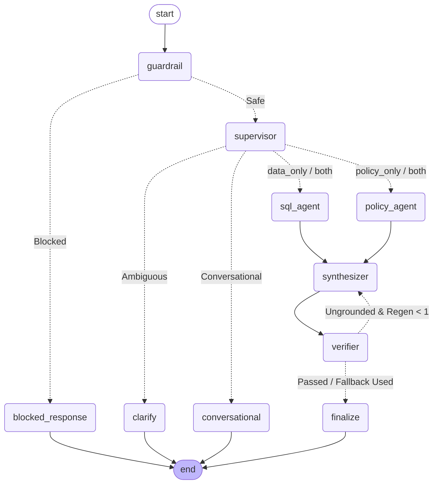
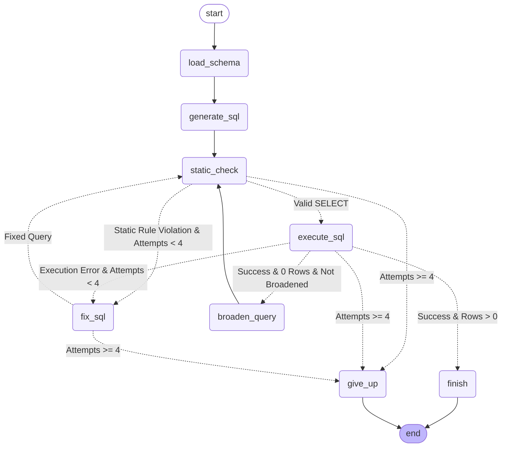
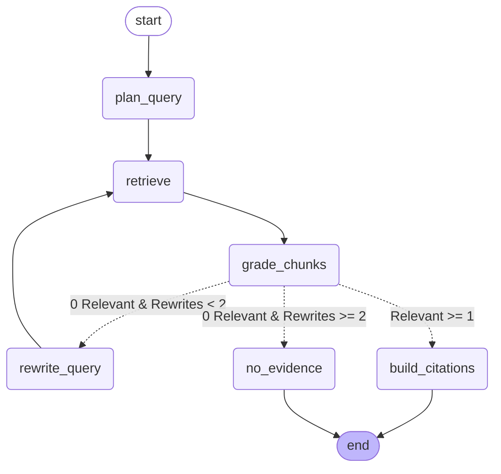
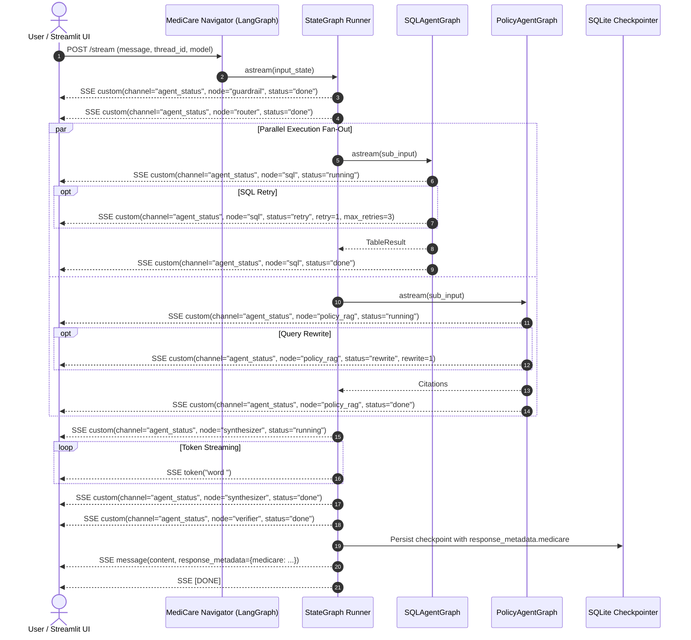
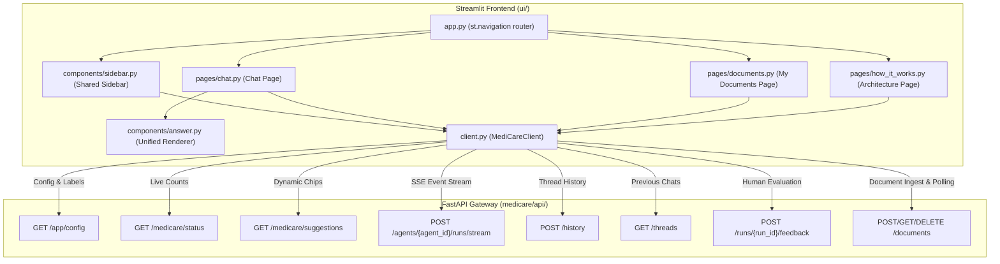

# MediCare & Claim Navigator Architecture

This document describes the LangGraph multi-agent architecture, compiled StateGraph topologies, bounded worker sub-graphs, and Server-Sent Events (SSE) streaming lifecycle of MediCare & Claim Navigator AI.

---

## 1. Top-Level Parent Graph (`MediCareGraph`)

The parent graph coordinates security guardrails, supervisor intent planning, parallel worker fan-out, response synthesis, and grounding verification.

### Parent Graph Execution Nodes:
1. **`guardrail`**: Evaluates pre-execution clinical emergencies, crisis/self-harm patterns, prompt injection threats, and redacts Indian PII (phone, Aadhaar, PAN, emails, claim IDs).
2. **`blocked_response`**: Emits safe, structured emergency advisory (Tele-MANAS `14416`, Emergency `112`) and terminates stream without worker invocations.
3. **`supervisor`**: Evaluates intent (`data_only`, `policy_only`, `both`, `conversational`, `clarify`), extracts & canonicalizes entities (`city`, `procedure`, `insurer`) via `difflib`, and manages conversational carry-over across turns.
4. **`conversational`**: Generates friendly greeting and capability explanation without invoking tool workers.
5. **`clarify`**: Proactively requests clarification for fundamentally ambiguous inquiries (e.g. underspecified comparison requests).
6. **`sql_agent`**: Invokes the Hospital SQL Agent sub-graph in parallel.
7. **`policy_agent`**: Invokes the Policy RAG Agent sub-graph in parallel.
8. **`synthesizer`**: Compiles evidence from SQL and Policy workers into a grounded 4-part structured markdown response and Vega-Lite chart spec.
9. **`verifier`**: Pure function validating numeric claims against table/citations, checking citation markers `[C1]`..`[Cn]`, and triggering 1 repair regeneration or deterministic fallback.
10. **`finalize`**: Emits terminal completion telemetry.

---

## 2. Hospital SQL Sub-Graph (`SQLAgentGraph`)

The SQL worker runs a bounded cyclic sub-graph (`medicare/medicare/graph/sql_subgraph.py`):

### Self-Correction & Safety Features:
- **`static_check`**: Pre-execution AST/regex validation ensuring queries are strictly read-only `SELECT`, rejecting DDL/DML, stacked statements (`;`), `sqlite_master` access, and enforcing a `LIMIT 50` row cap.
- **Repeated SQL Detection**: Flags identical queries across attempts to avoid infinite error loops.
- **Dynamic Broadening**: When a valid query returns 0 rows (e.g. strict procedure match), re-executes query with `LIKE '%partial%'` to maximize recall.
- **Bounded Attempts**: Exactly 1 initial query + up to 3 self-correction retries.

---

## 3. Policy RAG Sub-Graph (`PolicyAgentGraph`)

The policy worker runs a corrective RAG sub-graph (`medicare/medicare/graph/policy_subgraph.py`):

### Features:
- **Hybrid Dense + Sparse Search**: Combines ChromaDB cosine similarity with `BM25Okapi` sparse retrieval using Reciprocal Rank Fusion (RRF $K=60$).
- **Chunk Grading**: Filters out chunks lacking domain relevance and drops indirect prompt injections.
- **Query Rewriting**: Reformulates query terminology on retrieval misses (up to 2 rewrites).
- **Citation Extraction**: Generates structured citations with 1-based `[C1]`..`[Cn]` reference tags.

---

## 4. Server-Sent Events (SSE) Streaming Sequence

MediCare maintains full backward-compatibility with frontend SSE streaming contracts:

---

## 5. Frontend UI Architecture (`ui/`)

The Streamlit UI is built with native Streamlit 1.67+ components following a decoupled, HTTP-only client-server pattern:

### UI Architectural Invariants:
1. **HTTP Only**: The UI has zero imports from the backend `medicare` package.
2. **Zero Hardcoded Data**: All domain entities, labels, titles, and capability cards are injected via `GET /app/config` and `config/app.yaml`.
3. **Identical Message Rendering**: Both live streams and historical conversation thread messages render through the exact same function (`render_assistant_answer`).
4. **Isolated Fragment Polling**: `@st.fragment` manages live status polling for background document indexing and sidebar status without triggering full page reruns.
5. **No Voice Prototype Code**: Voice audio features are explicitly excluded (`features.voice = false`), ensuring clean production focus on tabular, procedural, and policy intelligence.
