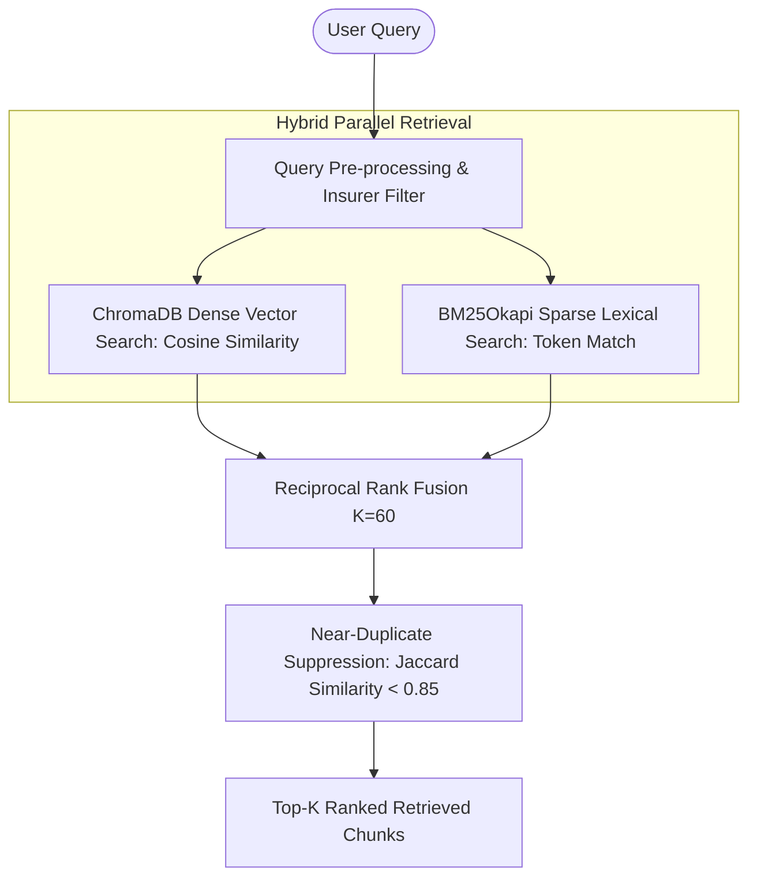
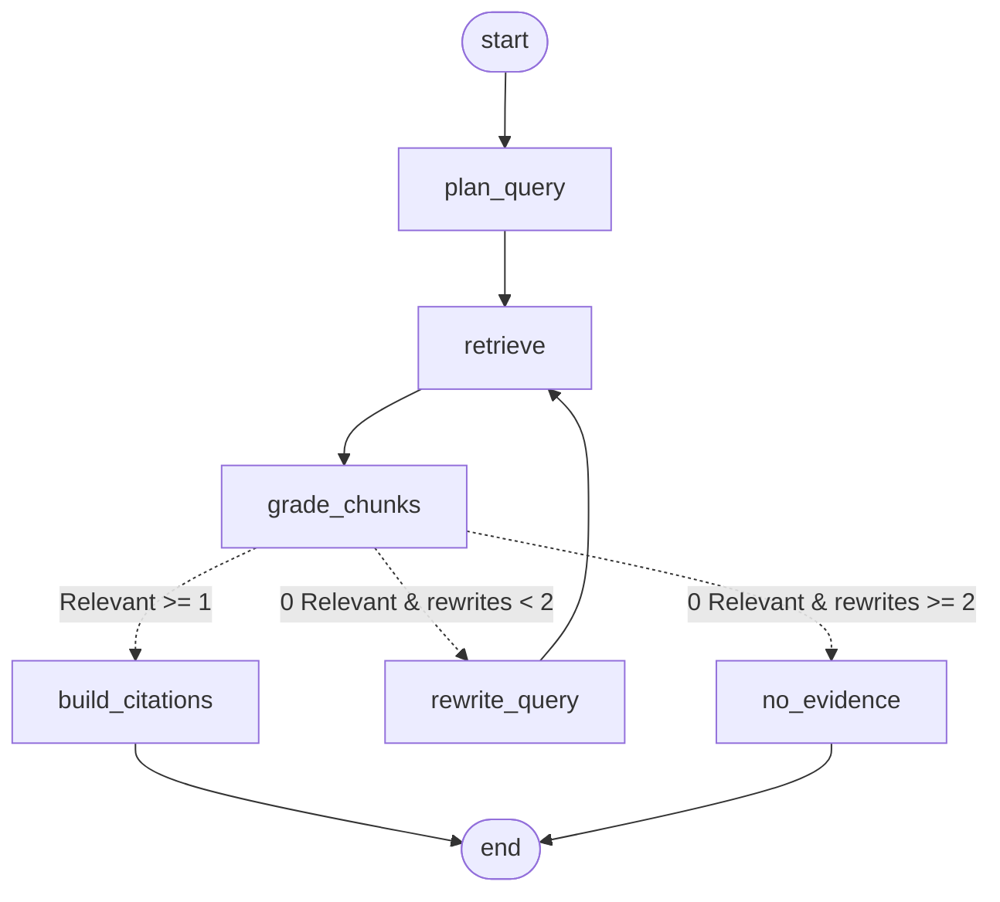

# Multi-Format RAG & Hybrid Retrieval Architecture

This document describes the multi-format document ingestion pipeline, hybrid search (dense + BM25), reciprocal rank fusion (RRF), corrective RAG sub-graph, and strict tenant isolation in MediCare / MediCare Navigator.

---

## 1. Multi-Format Ingestion Pipeline

The RAG subsystem (`medicare/rag/`) supports 6 common document formats:

| Format | Extension | Loader Implementation | Heading & Structure Preservation |
|---|---|---|---|
| **PDF** | `.pdf` | `load_pdf` via `pypdf` | 1-based page indexing, hyphenated line un-breaking, repeated header/footer suppression (>60% page recurrence). |
| **Word DOCX** | `.docx` | `load_docx` via `python-docx` | Heading hierarchy extraction (`Heading 1-3`), paragraphs, and formatted table cell extraction. |
| **Markdown** | `.md` | `load_markdown` | Heading path tracking (`# H1 > ## H2 > ### H3`), paragraph preservation, and list retention. |
| **Plain Text** | `.txt` | `load_text` | Double-newline paragraph splitting and whitespace normalization. |
| **HTML** | `.html`, `.htm` | `load_html` via `BeautifulSoup` | Strips `<script>`, `<style>`, `<nav>`, `<header>`, `<footer>`; extracts headings (`h1-h3`), paragraphs, and lists. |
| **CSV** | `.csv` | `load_csv_data` | Converts table rows into structured `field: value` key-value lines grouped into 10-row units. |

---

## 2. Structure-Aware Chunking

Implemented in `medicare/rag/chunking.py`:
- **Deterministic Chunk IDs:** Generates unique, repeatable IDs: `{doc_id}-{chunk_index}-{sha256[:16]}`.
- **Physical Boundary Preservation:** Chunks never cross physical page boundaries (`c.page == page.page`).
- **Heading Path Context:** Prepends hierarchical section headers (e.g., `Waiting Periods > Pre-Existing Diseases`) to each chunk.
- **Size Bounds:** Target 400 characters (configurable via `RAG_CHUNK_CHARS`), with 50-character sliding sentence overlap (`RAG_CHUNK_OVERLAP`).

---

## 3. Hybrid Search & Reciprocal Rank Fusion (RRF)

Implemented in `medicare/rag/retriever.py` and `medicare/rag/bm25.py`:

### Fusion Formula
For every candidate chunk $d$:
$$RRF(d) = \sum_{m \in \{\text{dense}, \text{bm25}\}} \frac{1}{60 + \text{rank}_m(d)}$$

Near-duplicate chunks exhibiting Jaccard token similarity $> 0.85$ against a higher-ranked chunk are suppressed to maximize citation diversity.

---

## 4. Corrective RAG Sub-Graph (`PolicyAgentGraph`)

The policy worker runs a compiled LangGraph sub-graph (`medicare/medicare/graph/policy_subgraph.py`):

### Sub-Graph Stages:
1. **`plan_query`**: Formulates search query incorporating insurer entity and medical inquiry.
2. **`retrieve`**: Executes HybridRetriever across dense and BM25 indices respecting user scope.
3. **`grade_chunks`**: Evaluates retrieved chunks:
   - **Relevance Grading:** Verifies lexical overlap with domain vocabulary (waiting period, exclusions, copay, pre-auth).
   - **Safety Boundary:** Filters out chunks containing indirect prompt injections (`ignore instructions`, `override system`).
4. **`rewrite_query`**: On zero relevant chunks, reformulates query focusing on core policy terminology (up to 2 rewrites).
5. **`build_citations`**: Formats verified relevant chunks into formal `Citation` objects with `[C1]`..`[Cn]` reference markers.

---

## 5. Multi-Tenant Document Isolation

Implemented in `medicare/api/routes/documents.py` and `medicare/rag/store.py`:
- **Document Scopes:**
  - `curated`: System-wide official policy documents in `data/policies/`.
  - `user`: Uploaded by authenticated users via `POST /documents`.
- **Query Scopes:**
  - `both`: Searches curated documents plus documents owned by the caller (`user_id`).
  - `curated`: Searches only curated documents.
  - `mine`: Searches only documents owned by the caller.
- **Tenant Enforcement:**
  - In ChromaDB: `{"$or": [{"scope": "curated"}, {"user_id": user_id}]}`.
  - In BM25: In-memory filter function ensures User A can never see User B's private documents.
